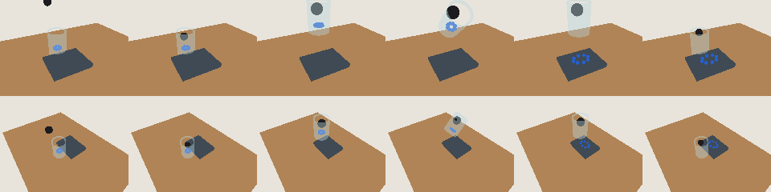

# Reachy 2023：用 Quest 2 教它拿起烧杯、倒出、放下

这个仓库把一件具体的模仿学习实验备好了。机器人是 **Reachy 2023**（不是 Reachy 2）。人戴 **Meta Quest 2** 和原装手柄做示范，数据走 [LeRobot](https://github.com/huggingface/lerobot) 的录制、ACT 训练和评估。桌子和烧杯用 [Blender](blender/build_pour_scene.py) 建，尺寸和练习程序读的是同一份 [`configs/pour_bench.json`](configs/pour_bench.json)。

任务只有三步：

1. 拿起烧杯
2. 把里面的物体倒进旁边的托盘
3. 把烧杯放回桌上

LeRobot 文档里的 `reachy2` 机器人类型连的是 Reachy 2 的 `reachy2_sdk`。2023 的 Python 接口是 [`reachy-sdk`](https://github.com/pollen-robotics/reachy-sdk)，官方 VR 程序是 [ReachyTeleoperation](https://github.com/pollen-robotics/ReachyTeleoperation)（Unity **2020.3**）。本仓库按 LeRobot 现在的插件规则补上 2023，不改 LeRobot 源码。

## 两条遥操作，不要混在一个 Unity 工程里

| | 官方 ReachyTeleoperation | 本仓库的 Unity 场景 |
| --- | --- | --- |
| 用途 | 真机示范。推荐先用这条 | 把头显里的桌子、烧杯摆出来，自己改场景 |
| Unity | 2020.3，带他们的 gRPC | 2022.3，脚本在 `unity/ReachyPourTeleop` |
| 谁给电机发目标 | VR 程序直接发 | `reachy-pour serve --arm` 用 SDK 逆解后发 |
| LeRobot 怎么录 | `--robot.use_external_commands=true`，本进程只读 | `--teleop.mode=quest`，本进程既解算也记录 |

官方程序的按键（Quest 2）：

- **A**：开始遥操作。按下去的那一刻头显朝向就是身体坐标，之后不要挪脚
- **右手食指扳机**：右夹爪
- **B**：底盘加速（这个实验不要用底盘）
- 回到镜像房间再摘头显。遥操作中摘头显，机器人还会跟着动

自建场景的按键（`QuestTeleopPublisher`）：

- **A**：校准身体朝向
- **右手食指扳机**：右夹爪，按下为闭合
- **Y**：开始或结束一条示范
- **B**：急停，电机卸力

## 没有机器人时，先把流水线跑通

练习数据是运动学卡通：关节来自本地逆解，烧杯跟着夹爪走，倒的时候手腕和画面一起倾斜。它用来确认“录下来的状态、动作、两个相机、阶段”能写进数据集。**不要拿这批图去训练然后部署到真机。** 真机策略必须用 Quest 示范。

```bash
python3 -m venv .venv
source .venv/bin/activate
pip install -e ".[dev]"
reachy-pour bench
reachy-pour practice --episodes 2 --out datasets/practice
reachy-pour validate datasets/practice
```

下图是一条练习示范。上排是桌侧相机，下排是头相机，从左到右是接近、抓取、提起、倾倒、放下、撤回。终端会打印每条的逆解误差。误差突然变大，就改 `configs/pour_bench.json` 里烧杯和托盘的位置，让它们离肩部近一点。



当前默认尺寸（肩部中点为原点，+X 向前，+Y 向机器人左侧，+Z 向上）：

- 桌面 70 × 50 cm，台面在原点下方 30 cm
- 烧杯外径 7 cm、高 9.5 cm，在右前方
- 托盘 14 × 11 cm，在烧杯更靠右的一侧
- 烧杯里 8 颗小球

这些数是按公开的手臂尺寸（上臂 28 cm、前臂 25 cm）放进可达范围的。真机肩高和桌子不一定一样，录之前用尺子改 JSON。

## Blender 里的桌子和烧杯

Blender 的轴是 X 向右、Y 向前、Z 向上。脚本把 Reachy 坐标换成：

- Blender X = −Reachy Y
- Blender Y = Reachy X
- Blender Z = Reachy Z

```bash
blender --background --python blender/build_pour_scene.py -- --out assets/pour_bench.blend
```

没有 Blender 时，直接导出同一尺寸的 glTF：

```bash
reachy-pour export-scene --out assets/pour_bench.gltf
```

实物按 `reachy-pour bench` 打印的厘米数来摆。Blender 文件是规格，也是放进 Unity 的模型。策略看的是真机相机，不是这张渲染图。

## 装到 LeRobot 里

在同一个虚拟环境里先按 [LeRobot 的安装说明](https://github.com/huggingface/lerobot) 装好 `lerobot`，然后：

```bash
pip install -e ".[robot]"
pip install -e lerobot_robot_reachy2023
pip install -e lerobot_teleoperator_reachy2023
```

`reachy-sdk` 是 2023 的 SDK。不要装成 `reachy2_sdk`。

插件名：

- `--robot.type=reachy2023`
- `--teleop.type=reachy2023_vr`

## 用官方 Quest 程序录 50 条

机器人、录制电脑用网线。Quest 和它们在同一个局域网。头、两个相机的位置在整个采集里不要动。在官方程序的设置里关掉底盘、天线，头也建议关掉，只留右臂。左臂这个实验用不到。

先看关节和相机是不是通的：

```bash
reachy-pour check --host 192.168.0.42
```

把打印出来的夹爪张开、夹紧角度写进 `configs/pour_bench.json` 的 `gripper_open_deg` 和 `gripper_closed_deg`。

官方程序负责动，本进程只读 `goal_position` 当作动作、`present_position` 当作观测。这和 LeRobot 给 Reachy 2 VR 写的 `use_external_commands` 是同一件事。

```bash
reachy-pour record --mode external --host 192.168.0.42 \
  --episodes 50 --seconds 20 --out datasets/teleop \
  --table-camera 0 --width 320 --height 240
```

一个人戴头显，另一个人在电脑前按 Enter 开始一条，做完回答这条是否成功。烧杯每次在桌面上挪一两厘米，倒的方式和放下的位置保持一致。相机里要看得见烧杯和托盘。LeRobot 的经验是先收 50 条成功示范。

同一条路径也可以直接进 LeRobot 的记录器（插件装好之后）：

```bash
lerobot-record \
  --robot.type=reachy2023 \
  --robot.ip_address=192.168.0.42 \
  --robot.use_external_commands=true \
  --robot.torque_on_connect=false \
  --robot.arm=right \
  --teleop.type=reachy2023_vr \
  --teleop.mode=external \
  --teleop.ip_address=192.168.0.42 \
  --dataset.repo_id=${HF_USER}/reachy2023-pour \
  --dataset.single_task="Pick up the beaker, pour the objects into the tray, and put the beaker down." \
  --dataset.num_episodes=50 \
  --dataset.episode_time_s=20 \
  --dataset.fps=15 \
  --dataset.push_to_hub=false \
  --display_data=true
```

ACT 本身不读这句话。句子留给以后的语言条件策略，所以用英文，和公开的 LeRobot 数据一致。中文说法在 `reachy-pour bench` 里。

桌侧如果另有一个 USB 相机，加上：

```bash
--robot.cameras="{ table: {type: opencv, index_or_path: 0, width: 640, height: 480, fps: 30}}"
```

头部两个相机会以 `head_left`、`head_right` 写进观测。SDK 的图按文档是 BGR，插件默认转成 RGB。

录完看一条：动作和状态应该差一点。如果几乎重合，官方程序可能没把目标写进 `goal_position`，那时给 teleop 加上 `--teleop.use_present_position=true`（命令行记录器对应 `--present`）。

## 自建 Unity 场景

1. 用 Unity 2022.3 打开 `unity/ReachyPourTeleop`，或把 `Assets/ReachyPour` 拷进你自己的 2022.3 工程。
2. Package Manager 安装 XR Plugin Management，Android 平台勾上 Oculus。Quest 2 的构建目标是 Android、ARM64、IL2CPP。
3. 把 `assets/pour_bench.gltf` 拖进场景。这是视觉参照，数值仍以 JSON 为准。
4. 空物体挂上 `ReachyPour.QuestTeleopPublisher`，`host` 填运行 Python 的电脑 IP，不是机器人 IP。端口 `29023`。
5. 先干跑，确认逆解误差在一两厘米：

```bash
reachy-pour serve --bind 0.0.0.0 --port 29023
```

6. 工作台清空之后才允许上力。单周期最多追 5 度，温度超过 55°C 会卸力：

```bash
reachy-pour serve --host 192.168.0.42 --arm --max-delta 5
```

录制：

```bash
reachy-pour record --mode quest --host 192.168.0.42 --arm \
  --episodes 50 --seconds 20 --out datasets/teleop
```

对应的 LeRobot 记录器把 `--teleop.mode=quest`，并且 `--robot.use_external_commands=false`、`--robot.torque_on_connect=true`。官方 VR 程序这时不要开着，两边会抢电机。

## 训练 ACT

ACT 是 LeRobot 建议的第一个策略：动作分块，几十条示范就能开始看结果。练习数据集要先转成 LeRobot 格式；真机用 `lerobot-record` 时已经是那个格式。

```bash
reachy-pour export-lerobot --src datasets/practice --repo-id local/reachy2023-pour --out datasets/lerobot/reachy2023_pour
DEVICE=cpu bash scripts/train_act.sh
```

真机数据把 `DATASET_ROOT` 指到 `lerobot-record` 写下的目录，`REPO_ID` 用同一个 `--dataset.repo_id`。默认设备是 CUDA。没有 GPU 就 `DEVICE=cpu`，只适合把命令跑通。

```bash
lerobot-train \
  --dataset.repo_id=${HF_USER}/reachy2023-pour \
  --policy.type=act \
  --output_dir=outputs/train/reachy2023_pour \
  --job_name=reachy2023_pour \
  --policy.device=cuda \
  --policy.repo_id=${HF_USER}/reachy2023_pour_act
```

## 评估

评估时 Quest 程序退出，由策略发关节目标。`max_relative_target=5` 限制每一拍最多动 5 度。

```bash
REACHY_HOST=192.168.0.42 bash scripts/eval_policy.sh
```

回放某一条录好的动作，默认只读文件。加上 `--arm` 才会驱动真机：

```bash
reachy-pour replay datasets/practice --episode 0
reachy-pour replay datasets/teleop --episode 0 --host 192.168.0.42 --arm
```

## 安全

- `serve` 和 `replay` 不加 `--arm` 不会给电机上力。
- 官方程序遥操作时，本进程必须是 external，不能同时 `send_action`。
- 按 B，或温度超过 55°C，会 `turn_off_smoothly`。
- 逆解目标超出工作空间就停在上一拍，不追出去。
- `--arm` 时 UDP 29023 在局域网里是开着的。谁都能把包发过来，所以只在实验的网络里开。
- 结束遥操作再摘头显。手臂放低一点再卸力，避免砸到桌子。

## 目录

```
reachy_pour/                 运动学、练习示范、数据集、Quest UDP、SDK 会话
lerobot_robot_reachy2023/   --robot.type=reachy2023
lerobot_teleoperator_reachy2023/
configs/pour_bench.json      桌子、烧杯、托盘、相机、夹爪角度
blender/build_pour_scene.py
unity/ReachyPourTeleop/      Quest 2 发包脚本
scripts/train_act.sh
scripts/eval_policy.sh
```

关节顺序和 SDK 一致：`r_shoulder_pitch`、`r_shoulder_roll`、`r_arm_yaw`、`r_elbow_pitch`、`r_forearm_yaw`、`r_wrist_pitch`、`r_wrist_roll`，再加 `r_gripper`。角度是度。本地正运动学用的是 [Reachy 2023 文档](https://pollen-robotics.github.io/reachy-2023-docs/sdk/first-moves/kinematics/)里的那张连杆表。连上真机后，优先用 `reachy.r_arm.inverse_kinematics`，那个解在机器人自己的运动学服务里。
